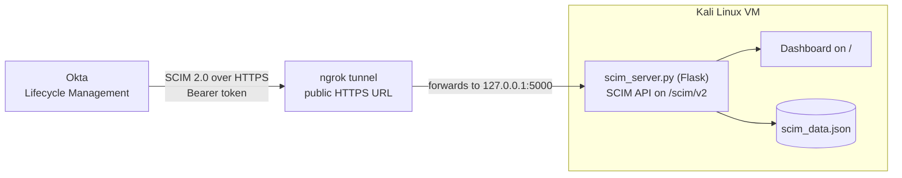
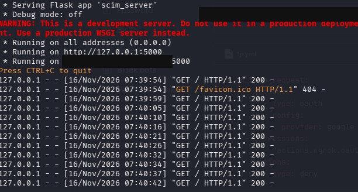

# Okta SCIM 2.0 Provisioning Lab on Kali Linux: Joiner, Mover, Leaver

A hands-on lab that uses **Okta Lifecycle Management** to provision users into an application I built myself: a small **SCIM 2.0 server written in Python (Flask)** that runs on a **Kali Linux VM** and is exposed to Okta through an **ngrok HTTPS tunnel**.

I tested the full user lifecycle: creating a user (joiner), updating their profile (mover), deactivating them (leaver), and pushing a group. Because I own the target app, I could watch the **actual SCIM requests** Okta sent, not just the result in the Okta console.

> **Note:** All tokens, tunnel hostnames, Okta org identifiers, the lab machine's network addresses and personal email addresses in this repository are either placeholders (`<like-this>`) or blacked out in the screenshots.

## Table of contents

- [Project goal](#project-goal)
- [Architecture](#architecture)
- [Key concepts](#key-concepts)
- [Repository contents](#repository-contents)
- [Quick start](#quick-start)
- [Walkthrough](#walkthrough)
- [Lifecycle tests](#lifecycle-tests)
- [Evidence from the running lab](#evidence-from-the-running-lab)
- [Results summary](#results-summary)
- [Troubleshooting](#troubleshooting)
- [Security notes and limitations](#security-notes-and-limitations)
- [Future work](#future-work)

## Project goal

- Connect Okta to a SCIM 2.0 application using a bearer token
- Automatically **create** a user in the app when they are assigned in Okta
- Automatically **update** the app when the user's Okta profile changes
- Automatically **deactivate** the user in the app when access is removed
- **Push** an Okta group to the app
- Capture the evidence for each event: server log, tunnel inspector and Okta System Log

## Architecture



| Component | Role |
|---|---|
| Okta (free trial org) | Identity source; sends the SCIM provisioning requests |
| `scim_server.py` (Python / Flask) | The target application; implements the SCIM 2.0 Users and Groups endpoints and a dashboard |
| ngrok | Gives the local server a public HTTPS URL that Okta's cloud can reach |
| Kali Linux VM | Hosts the server and the tunnel |
| Bearer token | Authenticates Okta to the SCIM server |

## Key concepts

| Term | Meaning |
|---|---|
| **SCIM 2.0** | System for Cross-domain Identity Management. An open standard (RFC 7643 and RFC 7644) for creating, updating and deactivating user accounts across systems with a REST API |
| **Provisioning** | Creating or updating a user's account in an app automatically |
| **Deprovisioning** | Removing or deactivating a user's access automatically |
| **Joiner / Mover / Leaver** | The three lifecycle events: a new hire, a role change, and a departure |
| **Bearer token** | A secret sent in the `Authorization` header that proves the caller may use the API |
| **Group push** | Okta creates a group in the app and syncs its members that are assigned to the app |

## Repository contents

```text
.
├── README.md                  This walkthrough
├── scim_server.py             SCIM 2.0 server (Flask): Users, Groups, dashboard
├── scim_data.sample.json      Sanitized example of the data the server stores
├── .gitignore                 Keeps runtime data and secrets out of git
└── screenshots/               Evidence referenced below (sensitive values blacked out)
```

The server writes its data to `scim_data.json` while it runs. That file is git-ignored on purpose, because it can hold real user data.

## Quick start

Run these on the Kali VM. Replace the placeholders with your own values.

```bash
# 1. Install Flask from Kali's package manager (Kali blocks global pip installs)
sudo apt update && sudo apt install -y python3-flask

# 2. Start the server with a token of your choice
export SCIM_TOKEN="<your-token>"          # for example: openssl rand -hex 24
python3 scim_server.py

# 3. In a second terminal, start the tunnel (first time only: add your authtoken)
ngrok config add-authtoken <your-ngrok-authtoken>
ngrok http 127.0.0.1:5000

# 4. In a third terminal, seed one user so Okta's connector test has something to import
curl -s -X POST http://localhost:5000/scim/v2/Users \
  -H "Authorization: Bearer $SCIM_TOKEN" \
  -H "Content-Type: application/json" \
  -d '{"userName":"seed.user@scimlab.test","name":{"givenName":"Seed","familyName":"User"},"active":true}' \
  | python3 -m json.tool
```

Your **SCIM base URL** for Okta is the ngrok Forwarding URL plus `/scim/v2`:

```text
https://<your-ngrok-hostname>/scim/v2
```

Quick health check (expect `200 OK`; a `401` means the server is up but the token is wrong):

```bash
curl -i http://localhost:5000/scim/v2/ServiceProviderConfig -H "Authorization: Bearer $SCIM_TOKEN"
```

## Walkthrough

### Step 1: Start the SCIM server

I started the server with a fixed bearer token so it stays the same across restarts. Flask reports it is serving on port 5000, and the SCIM API lives under `/scim/v2` with a dashboard at `/`.

)

### Step 2: Expose the server with ngrok

Okta runs in the cloud and cannot reach `localhost`, so I used ngrok to create a public HTTPS tunnel. I authenticated the agent with my account's authtoken (masked in the screenshot) and pointed the tunnel at `127.0.0.1:5000`.


The tunnel reports `online` and lists the requests it forwards. The repeating `GET /` lines are the dashboard refreshing every 5 seconds.


### Step 3: Check the whole lab on Kali

Both terminals and the dashboard side by side. The dashboard is opened through the public ngrok address, which shows the tunnel works end to end.


### Step 4: Create the app integration in Okta

The Okta catalog has a SCIM test app, which I looked at first.


The final integration is a custom **SAML 2.0** app named **SCIM Lab App**, because that type of app can have SCIM provisioning attached. The ngrok URL goes into the **Single sign-on URL** and **Audience URI** fields only because Okta requires values there. Single sign-on is not tested in this lab.


### Step 5: Enable SCIM provisioning

On the app's **General** tab, under **App Settings**, I set **Provisioning** to **SCIM**. This adds the **Provisioning** tab.


### Step 6: Connect Okta to the SCIM server

Under **Provisioning → Integration**, I configured the connector, then used **Test Connector Configuration**. Provisioning worked afterwards, as the next steps show.

| Field | Value |
|---|---|
| SCIM connector base URL | `https://<your-ngrok-hostname>/scim/v2` (lowercase, no trailing slash) |
| Unique identifier field for users | `userName` |
| Supported provisioning actions | Import New Users and Profile Updates, Push New Users, Push Profile Updates, Push Groups |
| Authentication mode | HTTP Header |
| Authorization | The bearer token (add the word `Bearer` first if the test returns 401) |

### Step 7: Enable lifecycle actions

Under **Provisioning → To App**, three actions are off at first:


I enabled **Create Users**, **Update User Attributes** and **Deactivate Users**:


### Step 8 (extra): Add a custom attribute

As an extra exercise I added a custom string attribute named **Region** in the Directory Profile Editor, with an enumerated list of values (AMER, APAC, EMEA).


## Lifecycle tests

Each test changed something in Okta and then checked the result on the SCIM app's dashboard.

### Joiner: create a user

Assigning SCIM Lab App to a user in Okta creates the account in the app. The assignment dialog shows the attributes Okta sends: username, external ID, given and family name, email, title and display name. The Title is still empty here.


### Mover: update a profile

I set the user's **Title** to `Engineer`.


The dashboard shows the new title with the user as **Active**.


### Leaver: deactivate a user

Removing a user's assignment in Okta deactivates the account in the app. The dashboard shows **Inactive** and the **Last modified** time moves forward. Okta deactivates instead of deleting, which keeps the account and its history for audits and allows reactivation if the app is assigned again.


### Group push

On the **Push Groups** tab I pushed the Okta group **IT** to the app. The push status is **Active**.


The group appears in the app's dashboard with its member count.


A group arrives with only those members who are also assigned to the app, which is why a pushed group can show 0 members.

## Evidence from the running lab

The same activity can be seen in three more places.

### What the server received

Between 07:50:07 and 07:50:11 on the Kali clock, the log shows a `PUT /scim/v2/Users/{id}` returning 200, a `GET` lookup with `filter=userName eq "Mohamed Elsayed"` returning 200, a `POST /scim/v2/Users` returning 201, and `GET` and `PUT` calls on `/scim/v2/Groups/{id}`. Okta first searches for the user by `userName` and then creates it, which is why `userName` is the unique identifier.


### The tunnel from the outside

ngrok's Traffic Inspector shows the request from Okta's side: at 7:50:09 AM a `GET /scim/v2/Groups/...` arrived from an address that ngrok labels as Amazon Web Services, consistent with Okta's cloud, and returned 200. The other rows are the browser loading the dashboard. The `/favicon.ico` row is the browser asking for a page icon, which the app does not serve.


### Okta's view

Okta's System Log marks every visible event as SUCCESS: push new user to external application, successfully pushed new user account to app, sync user in external application, push user deactivation to external application, deprovision user from external application, and the group push events for IT.


### The same events in three places

The times line up once time zones are accounted for:

| Source | Time shown | Time zone | Same moment in UTC |
|---|---|---|---|
| Okta System Log (visible events) | 14:50:08 to 14:50:12 | Cairo, UTC+2 | 12:50:08 to 12:50:12 |
| SCIM server log | 07:50:07 to 07:50:11 | US Eastern, UTC-5 (as ngrok labels it, EST) | 12:50:07 to 12:50:11 |
| Dashboard, Last modified column | 12:50:07 to 12:50:09 | UTC | 12:50:07 to 12:50:09 |

## Results summary

| Event | Action in Okta | SCIM call | Evidence |
|---|---|---|---|
| Connector test | Test Connector Configuration | `GET /Users` (expected) | Okta accepted the connector and provisioning worked afterwards |
| **Joiner** | Assign the app to a user | `POST /Users` returns 201 | Server log, Okta System Log, dashboard shows Active |
| **Mover** | Set Title to Engineer | `PUT /Users/{id}` (expected) | Dashboard Title column shows Engineer |
| **Leaver** | Unassign the user | `PUT /Users/{id}` returns 200 | Okta System Log deactivation event, dashboard shows Inactive |
| **Group push** | Push the IT group | `GET` and `PUT /Groups/{id}` return 200 | Server log, System Log group events, dashboard Groups table |

"Expected" means the dashboard confirms the result, but that specific request was not captured in a log screenshot.

## Troubleshooting

Getting the connection working took several fixes. Each one is a common real-world SCIM or tunnel issue.

| Symptom | Root cause | Fix |
|---|---|---|
| `401 Unauthorized` from the server | The token in the request did not match the one the server started with, and angle brackets from a placeholder (`<token>`) were sent literally | Restart the server with a fixed `SCIM_TOKEN` and send the same value, with no `<` `>` |
| ngrok `ERR_NGROK_8012`, connection refused to `localhost:8080` | The tunnel pointed at the wrong port, and `localhost` resolved to the IPv6 address `[::1]` while Flask listens on IPv4 | Run `ngrok http 127.0.0.1:5000` |
| ngrok `421`: request for a different host than the current tunnel | A placeholder hostname in capitals was used instead of the real one | Use the hostname exactly as ngrok shows it, in lowercase |
| ngrok `ERR_NGROK_3200`: endpoint is offline | A placeholder hostname that is not a real tunnel, or the tunnel was stopped | Read the real URL from the Forwarding line or from ngrok's local API at `http://127.0.0.1:4040` |
| Okta: "Invalid Base URL for the SCIM Connector" | A malformed or placeholder URL | Use `https://<real-hostname>/scim/v2` with no trailing slash and no spaces |

**Lesson:** the server's request log makes each failure easy to read. No request at all means a network or tunnel problem, a 404 means a wrong path, and a 401 means a token mismatch.

## Security notes and limitations

This is a lab. It is fine for learning and would need hardening before it handled real identities.

- **Static bearer token.** One shared secret protects the API. A real deployment would use OAuth 2.0 or a secrets manager and rotate the token. Treat any token that appeared in a screenshot or chat as burned.
- **Public endpoint.** ngrok exposes the server to the internet. The token is the only barrier, so an IP allowlist or mutual TLS would help.
- **Development server.** Flask's built-in server prints a warning for a reason. Production needs a WSGI server such as gunicorn behind a proper TLS terminator.
- **Plain JSON storage.** Users and groups are saved to a local JSON file with no encryption or access control.
- **Unstable URL.** Free ngrok URLs change on every restart, so the base URL in Okta must be updated each time.
- **Free trial limits.** The Okta trial org allows 10 active users, which is enough for these tests.

